<p align="center">
  
  <br>
  <sub>A lightweight, unified library for Serial Bluetooth Classic and Low Energy (BLE) communication on Android. 💙</sub>
</p>

<p align="center">
  <b>Android Bluetooth Library</b> provides a simple, robust, and unified solution for Serial Bluetooth Classic (SPP) and Bluetooth Low Energy (BLE GATT) communication on Android. Designed with asynchronous thread-safe I/O, automated delimiter-based packet framing, and seamless background-to-main thread dispatching.
</p>

<p align="center">
  <a href="LICENSE"></a>
  <a href="https://jitpack.io/#douglasjunior/AndroidBluetoothLibrary"></a>
  <a href="https://jitpack.io/#douglasjunior/AndroidBluetoothLibrary"></a>
  
  
  <a href="http://android-arsenal.com/details/1/5821"></a>
  <a href="https://github.com/douglasjunior/AndroidBluetoothLibrary/pulls"></a>
</p>

<p align="center">
  <a href="#-quick-start"><b>Quick Start</b></a> ·
  <a href="#-why-android-bluetooth-library">Why</a> ·
  <a href="#-compatibility">Compatibility</a> ·
  <a href="#-installation">Installation</a> ·
  <a href="#-configuration">Configuration</a> ·
  <a href="#-usage--examples">Usage</a> ·
  <a href="#-api-reference">API Reference</a> ·
  <a href="#known-issues--troubleshooting">Troubleshooting</a> ·
  <a href="#-contributing">Contributing</a>
</p>

---

## 🚀 Quick Start

1. Add the JitPack repository to your root `build.gradle`:

```groovy
allprojects {
    repositories {
        google()
        mavenCentral()
        maven { url "https://jitpack.io" }
    }
}
```

2. Add the dependency to your app module `build.gradle` (choose Classic or Low Energy):

```groovy
dependencies {
    // For Bluetooth Classic (API 7+)
    implementation 'com.github.douglasjunior.AndroidBluetoothLibrary:BluetoothClassicLibrary:0.3.5'

    // OR for Bluetooth Low Energy (API 18+)
    // implementation 'com.github.douglasjunior.AndroidBluetoothLibrary:BluetoothLowEnergyLibrary:0.3.5'
}
```

3. Initialize the service in your `Application` class or main activity:

```java
BluetoothConfiguration config = new BluetoothConfiguration();
config.context = getApplicationContext();
config.bluetoothServiceClass = BluetoothClassicService.class; // Or BluetoothLeService.class
config.bufferSize = 1024;
config.characterDelimiter = '\n';
config.deviceName = "Your App Name";
config.callListenersInMainThread = true;
config.uuid = UUID.fromString("00001101-0000-1000-8000-00805f9b34fb"); // Standard SPP UUID

BluetoothService.init(config);
```

4. Retrieve the service singleton and send a message:

```java
BluetoothService service = BluetoothService.getDefaultInstance();
BluetoothWriter writer = new BluetoothWriter(service);

// Send text terminated with the configured delimiter ('\n')
writer.writeln("Hello from Android!");
```

---

## 💡 Why Android Bluetooth Library?

- ⚡ **Unified Dual-Engine Architecture.** Switch between Bluetooth Classic and Bluetooth Low Energy by swapping a single service class name without rewriting your event listeners or UI code.
- 🔄 **Automated Framing & Delimiters.** Never struggle with fragmented TCP-like byte buffers again: automatically buffers incoming streams and triggers `onDataRead` upon reaching a custom delimiter (`\n`, `\r`, or custom bytes).
- 🧵 **Asynchronous Non-Blocking I/O.** Device connections, GATT handshakes, and byte streams run safely on isolated background worker threads, keeping your application responsive.
- 🎯 **Automatic Main Thread Dispatch.** Event callbacks (`onDataRead`, `onStatusChange`, `onDataWrite`, `onDeviceName`, `onToast`) are dispatched directly to Android's UI Main Thread by default.
- 📡 **Built-In Scanning & Filtering.** Discover nearby peripherals with real-time RSSI signal strength monitoring and target UUID filtering.
- 🚀 **LE Connection Priority Tuning.** Easily request high-throughput GATT connection parameters (`CONNECTION_PRIORITY_HIGH`) for fast data transfers.
- 🪶 **Modular & Zero Bloat.** Import only the sub-library you need (`BluetoothClassicLibrary` or `BluetoothLowEnergyLibrary`) with zero heavy external dependencies.
- 🤖 **Broad Android Support.** Battle-tested compatibility ranging from legacy Android 2.1 (API 7) up to modern Android versions.

---

## 📱 Compatibility

| Engine | Target | Minimum Android | Recommended Use Cases |
|---|---|---|---|
| **Bluetooth Classic** (`BluetoothClassicLibrary`) | RFCOMM / SPP | Android 2.1 (API 7+) | Arduino HC-05/HC-06, thermal receipt printers, barcode scanners, ELM327 OBD-II |
| **Bluetooth Low Energy** (`BluetoothLowEnergyLibrary`) | GATT Client | Android 4.3 (API 18+) | Nordic nRF, ESP32, HM-10, fitness trackers, smart home sensors, low-power IoT |

---

## 📦 Installation

### 1. Root Repository

Add the JitPack repository URL in your root `build.gradle` file at the end of repositories:

```groovy
allprojects {
    repositories {
        google()
        mavenCentral()
        maven { url "https://jitpack.io" }
    }
}
```

> [!NOTE]
> If your project uses Gradle 7+ with `dependencyResolutionManagement` in `settings.gradle`, add the `maven { url "https://jitpack.io" }` entry inside `repositoriesMode` block instead.

### 2. Module Dependencies

Add the module dependency in your app module's `build.gradle`:

#### Bluetooth Classic
```groovy
dependencies {
    implementation 'com.github.douglasjunior.AndroidBluetoothLibrary:BluetoothClassicLibrary:0.3.5'
}
```

#### Bluetooth Low Energy
```groovy
dependencies {
    implementation 'com.github.douglasjunior.AndroidBluetoothLibrary:BluetoothLowEnergyLibrary:0.3.5'
}
```

### 3. AndroidManifest Permissions

Add the required permissions to your `AndroidManifest.xml`:

```xml
<manifest xmlns:android="http://schemas.android.com/apk/res/android"
    package="your.package.name">

    <!-- Basic Bluetooth permissions -->
    <uses-permission android:name="android.permission.BLUETOOTH" />
    <uses-permission android:name="android.permission.BLUETOOTH_ADMIN" />
    <uses-permission android:name="android.permission.BLUETOOTH_PRIVILEGED" />

    <!-- Required for Bluetooth device scanning (Android 6.0+) -->
    <uses-permission android:name="android.permission.ACCESS_COARSE_LOCATION" />

    <!-- Optional: fine location for high accuracy scanning -->
    <uses-permission android:name="android.permission.ACCESS_FINE_LOCATION" />

</manifest>
```

> [!IMPORTANT]
> **Location Permission for Bluetooth Scanning:** Starting with Android 6.0 (API 23), Android requires runtime location permission to detect nearby Bluetooth devices. See [Troubleshooting](#known-issues--troubleshooting) for details.

---

## 🛠️ Configuration

Initialize the library once in your `Application.onCreate()` or before using any Bluetooth services.

### Bluetooth Classic

```java
import com.github.douglasjunior.bluetoothclassiclibrary.BluetoothClassicService;
import com.github.douglasjunior.bluetoothclassiclibrary.BluetoothConfiguration;
import com.github.douglasjunior.bluetoothclassiclibrary.BluetoothService;
import java.util.UUID;

BluetoothConfiguration config = new BluetoothConfiguration();
config.context = getApplicationContext();
config.bluetoothServiceClass = BluetoothClassicService.class;
config.bufferSize = 1024;
config.characterDelimiter = '\n';
config.deviceName = "My Android App";
config.callListenersInMainThread = true;

// Standard Serial Port Profile (SPP) UUID (Required for Classic)
config.uuid = UUID.fromString("00001101-0000-1000-8000-00805f9b34fb");

BluetoothService.init(config);
```

### Bluetooth Low Energy (BLE)

```java
import android.bluetooth.BluetoothDevice;
import android.bluetooth.BluetoothGatt;
import com.github.douglasjunior.bluetoothclassiclibrary.BluetoothConfiguration;
import com.github.douglasjunior.bluetoothclassiclibrary.BluetoothService;
import com.github.douglasjunior.bluetoothlowenergylibrary.BluetoothLeService;
import java.util.UUID;

BluetoothConfiguration config = new BluetoothConfiguration();
config.context = getApplicationContext();
config.bluetoothServiceClass = BluetoothLeService.class;
config.bufferSize = 1024;
config.characterDelimiter = '\n';
config.deviceName = "My Android App";
config.callListenersInMainThread = true;

// Custom or standard GATT Service & Characteristic UUIDs (Required for BLE)
config.uuidService = UUID.fromString("e7810a71-73ae-499d-8c15-faa9aef0c3f2");
config.uuidCharacteristic = UUID.fromString("bef8d6c9-9c21-4c9e-b632-bd58c1009f9f");

// Transport preference for dual-mode devices
config.transport = BluetoothDevice.TRANSPORT_LE;

// Optional: Filter devices by UUID during scan (set null to scan all BLE devices)
config.uuid = null;

// Optional: Automatically request high throughput priority upon connection
config.connectionPriority = BluetoothGatt.CONNECTION_PRIORITY_HIGH;

BluetoothService.init(config);
```

### Kotlin Configuration Example

```kotlin
val config = BluetoothConfiguration().apply {
    context = applicationContext
    bluetoothServiceClass = BluetoothClassicService::class.java // or BluetoothLeService::class.java
    bufferSize = 1024
    characterDelimiter = '\n'
    deviceName = "My Kotlin App"
    callListenersInMainThread = true
    uuid = UUID.fromString("00001101-0000-1000-8000-00805f9b34fb")
}

BluetoothService.init(config)
```

---

## 💻 Usage & Examples

### 1. Obtaining the Service Instance

Once initialized via `BluetoothService.init(config)`, retrieve the singleton anywhere in your app:

```java
BluetoothService service = BluetoothService.getDefaultInstance();
```

### 2. Scanning for Devices

Register `OnBluetoothScanCallback` to receive discovery events and start scanning:

```java
service.setOnScanCallback(new BluetoothService.OnBluetoothScanCallback() {
    @Override
    public void onDeviceDiscovered(BluetoothDevice device, int rssi) {
        Log.d("Bluetooth", "Discovered: " + device.getName() + " [" + device.getAddress() + "] RSSI: " + rssi);
    }

    @Override
    public void onStartScan() {
        Log.d("Bluetooth", "Scan started");
    }

    @Override
    public void onStopScan() {
        Log.d("Bluetooth", "Scan finished");
    }
});

// Start scanning (BLE scans run for 10 seconds by default)
service.startScan();

// Stop scanning at any time
// service.stopScan();
```

### 3. Connecting to a Device & Listening to Events

Register `OnBluetoothEventCallback` to monitor connection state changes and incoming data:

```java
service.setOnEventCallback(new BluetoothService.OnBluetoothEventCallback() {
    @Override
    public void onStatusChange(BluetoothStatus status) {
        // Status can be: NONE, CONNECTING, or CONNECTED
        Log.d("Bluetooth", "Status changed: " + status);
    }

    @Override
    public void onDeviceName(String deviceName) {
        Log.d("Bluetooth", "Connected device name: " + deviceName);
    }

    @Override
    public void onToast(String message) {
        Toast.makeText(context, message, Toast.LENGTH_SHORT).show();
    }

    @Override
    public void onDataRead(byte[] buffer, int length) {
        String message = new String(buffer, 0, length);
        Log.d("Bluetooth", "Received: " + message);
    }

    @Override
    public void onDataWrite(byte[] buffer) {
        Log.d("Bluetooth", "Data sent successfully");
    }
});

// Connect to a discovered or paired BluetoothDevice
service.connect(device);

// Disconnect when done
// service.disconnect();
```

### 4. Writing Data

The library provides a handy `BluetoothWriter` helper to write strings, numbers, characters, or line-delimited messages:

```java
BluetoothWriter writer = new BluetoothWriter(service);

// Write text and automatically append characterDelimiter ('\n')
writer.writeln("CMD:READ_SENSORS");

// Write text without trailing delimiter
writer.write("RAW_DATA");

// Write integer or character
writer.write(42);
writer.write('A');

// Write raw byte array directly via service
service.write(new byte[]{ 0x02, 0x55, 0x03 });
```

### 5. Requesting Connection Priority (BLE)

For high-throughput BLE data transfer, request higher connection priority at runtime:

```java
if (Build.VERSION.SDK_INT >= Build.VERSION_CODES.LOLLIPOP) {
    service.requestConnectionPriority(BluetoothGatt.CONNECTION_PRIORITY_HIGH);
}
```

### 6. Complete Sample Projects

Explore the full working sample applications in this repository:
- **Java Sample:** [`Sample`](Sample/src/main/java/com/github/douglasjunior/bluetoothsample) (features ESC/POS thermal printing, bitmap streaming, and device selection)
- **Kotlin Sample:** [`SampleKotlin`](SampleKotlin/src/main/java/com/github/douglasjunior/bluetoothsamplekotlin) (Kotlin implementation of scanning and communication)

---

## 📖 API Reference

### `BluetoothConfiguration`

| Property | Type | Description | Default |
|---|---|---|---|
| `bluetoothServiceClass` | `Class<? extends BluetoothService>` | Service implementation class (`BluetoothClassicService.class` or `BluetoothLeService.class`). | *Required* |
| `context` | `Context` | Android Application context reference. | *Required* |
| `deviceName` | `String` | Name of your application or device. | `null` |
| `bufferSize` | `int` | Maximum bytes retained in the read buffer before triggering `onDataRead`. | `0` |
| `characterDelimiter` | `char` | Delimiter character to frame complete packets. Triggers `onDataRead`. | `'\0'` |
| `callListenersInMainThread` | `boolean` | If `true`, callbacks are posted to the UI Main Thread; if `false`, called on the background thread. | `true` |
| `uuid` | `UUID` | Classic: target service UUID (SPP). BLE: UUID filter for scan discovery (or `null` for all devices). | `null` |
| `uuidService` | `UUID` | BLE: GATT service UUID to subscribe to. | `null` |
| `uuidCharacteristic` | `UUID` | BLE: GATT characteristic UUID for RX/TX notifications and write. | `null` |
| `transport` | `int` | Preferred GATT transport for dual-mode devices (`TRANSPORT_LE`, `TRANSPORT_BREDR`, `TRANSPORT_AUTO`). | Auto-set based on Android version |
| `connectionPriority` | `int` | BLE: Desired connection priority (`CONNECTION_PRIORITY_HIGH`, `BALANCED`, `LOW_POWER`). | `0` |

### `BluetoothService`

| Method | Parameters | Return | Description |
|---|---|---|---|
| `BluetoothService.init(config)` | `BluetoothConfiguration` | `void` | Initializes the singleton instance. Replaces existing service if active. |
| `BluetoothService.getDefaultInstance()` | None | `BluetoothService` | Returns the configured singleton instance. |
| `startScan()` | None | `void` | Starts scanning for remote Bluetooth devices. |
| `stopScan()` | None | `void` | Stops the active scan process. |
| `connect(device)` | `BluetoothDevice` | `void` | Initiates an asynchronous connection to the target device. |
| `disconnect()` | None | `void` | Disconnects the active Bluetooth connection. |
| `write(bytes)` | `byte[]` | `void` | Sends a byte array to the connected device. |
| `getStatus()` | None | `BluetoothStatus` | Returns the current state (`NONE`, `CONNECTING`, `CONNECTED`). |
| `getConfiguration()` | None | `BluetoothConfiguration` | Returns the active configuration instance. |
| `requestConnectionPriority(priority)` | `int` | `void` | Requests connection priority on BLE GATT links. |
| `stopService()` | None | `void` | Stops background threads and renders the service instance unusable. |
| `setOnScanCallback(callback)` | `OnBluetoothScanCallback` | `void` | Registers a listener for discovery events. |
| `setOnEventCallback(callback)` | `OnBluetoothEventCallback` | `void` | Registers a listener for connection and data events. |

### `BluetoothWriter`

| Method | Parameters | Description |
|---|---|---|
| `write(msg)` | `String` | Writes string bytes to the service. |
| `writeln(msg)` | `String` | Writes string bytes followed by the configured `characterDelimiter`. |
| `write(number)` | `Integer` | Writes integer string representation. |
| `write(c)` | `Character` | Writes character string representation. |

### `BluetoothStatus`

| Enum Constant | Description |
|---|---|
| `BluetoothStatus.NONE` | Disconnected or idle state. |
| `BluetoothStatus.CONNECTING` | Connection attempt in progress. |
| `BluetoothStatus.CONNECTED` | Actively connected to a remote peripheral. |

---

## Known Issues & Troubleshooting

<span id="known-issues"></span>

### 1. Bluetooth Scanning Doesn't Find Devices (Android 6.0+)

Starting with Android 6.0 Marshmallow (API 23), Android considers Bluetooth scanning capable of estimating user physical location. If your app does not obtain runtime location permission, `onDeviceDiscovered` will **not** be called, and no error will be thrown by the OS.

**Solution:**
Ensure you request `ACCESS_COARSE_LOCATION` (or `ACCESS_FINE_LOCATION`) at runtime before calling `startScan()`:

```java
if (Build.VERSION.SDK_INT >= Build.VERSION_CODES.M) {
    if (checkSelfPermission(Manifest.permission.ACCESS_COARSE_LOCATION) != PackageManager.PERMISSION_GRANTED) {
        requestPermissions(new String[]{ Manifest.permission.ACCESS_COARSE_LOCATION }, REQUEST_LOCATION_CODE);
    }
}
```

For more details, see the discussion on [StackOverflow](http://stackoverflow.com/a/33045489/2826279).

### 2. Android 12+ (API 31) Bluetooth Permissions

On Android 12 and above, the system introduced granular runtime permissions:
- `android.permission.BLUETOOTH_SCAN` (with `android:usesPermissionFlags="neverForLocation"` if you don't derive physical location)
- `android.permission.BLUETOOTH_CONNECT`

Make sure to declare and request these runtime permissions if targeting modern SDK levels.

### 3. BLE 20-Byte MTU Packet Limit

Standard Bluetooth Low Energy specification limits single-packet GATT payloads to 20 bytes by default. `BluetoothLeService` automatically splits larger buffers into chunks, but ensuring your peripheral firmware correctly reassembles packets or supports custom delimiters is recommended.

---

## 🤝 Contributing

Contributions, issues, and feature requests are welcome! For questions, bug reports, or suggestions, please open an [Issue](https://github.com/douglasjunior/AndroidBluetoothLibrary/issues).

### Development & Checks

Before submitting a pull request, ensure the Gradle build and connected verification pass:

```bash
./gradlew build connectedCheck
```

### Support the Author

If this library helped your project, consider supporting the maintainer:

<p align="left">
  <a href="https://www.patreon.com/douglasjunior"></a>
  &nbsp;
  <a href="https://paypal.me/douglasnassif"></a>
</p>

---

## ⭐ Star History

<p align="center">
  <a href="https://star-history.com/#douglasjunior/AndroidBluetoothLibrary&Date">
    <picture>
      <source media="(prefers-color-scheme: dark)" srcset="https://api.star-history.com/svg?repos=douglasjunior/AndroidBluetoothLibrary&type=Date&theme=dark" />
      
    </picture>
  </a>
</p>

---

## 📄 License

```text
The MIT License (MIT)

Copyright (c) 2015 Douglas Nassif Roma Junior
```

See the full [LICENSE](LICENSE) file for details.

---

## 🌐 Author & More Projects

<p align="center">
  <a href="https://douglasjunior.work">
    
  </a>
</p>

<p align="center">
  Discover more open-source libraries, creative animation engines, and developer tools at <a href="https://douglasjunior.work"><b>douglasjunior.work</b></a>.
</p>
